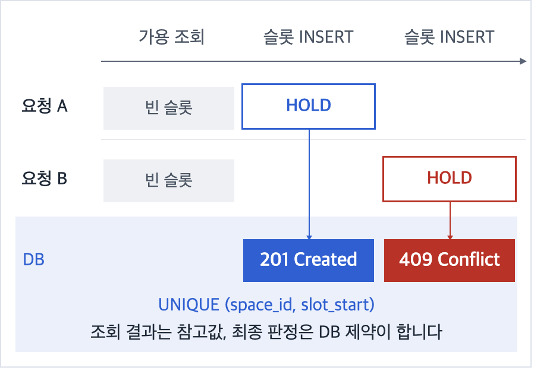
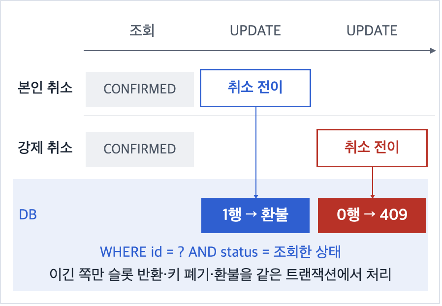
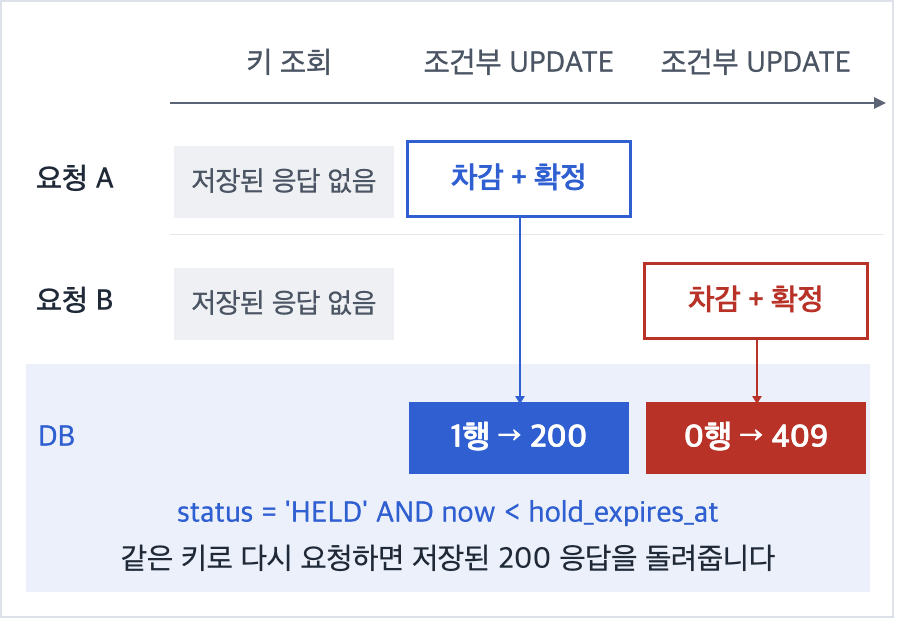
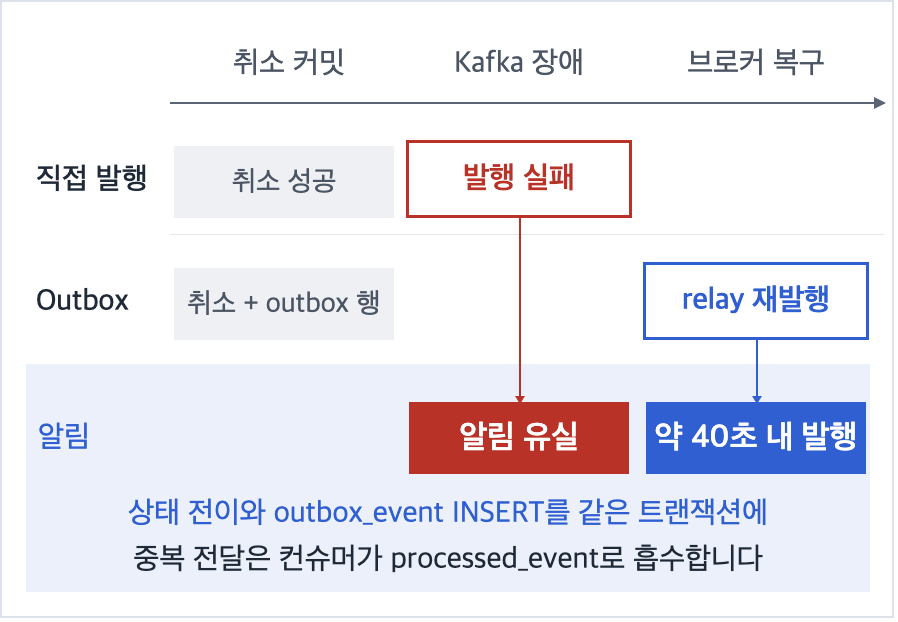
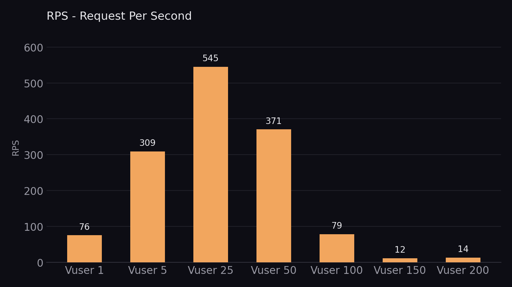
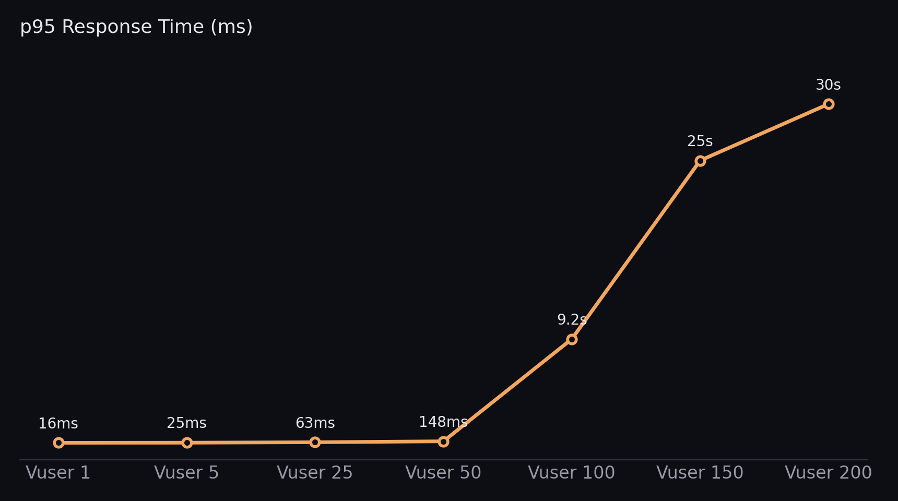

# 🔑 Slot Key

**회의실·공유오피스 30분 단위 예약 서비스(Spring Boot · MySQL)에서 예약 도메인과 동시성·환불·결제 멱등성을 설계하고, AWS 배포와 Outbox + Kafka 이벤트 경로를 구축한 프로젝트입니다.**
같은 슬롯 동시 HOLD 50건 중 1건만 성공, 같은 키 동시 결제 5건 중 1건만 차감, Kafka 장애 뒤 재시작 약 40초 안에 이벤트 발행을 확인했습니다.

## 👤 담당 역할 및 주요 구현

| 구분 | 구현 내용 | 위치 |
| --- | --- | --- |
| 예약 도메인 | HOLD(10분) → 결제 확정 → 체크인 → 체크아웃·취소·연장·노쇼·만료까지 예약 생명주기, 관리자 강제 취소, 만료·자동 체크아웃 스케줄러 | `reservation` (`ReservationController`, `AdminReservationController`) |
| 동시성 설계 | 슬롯 점유는 `UNIQUE(space_id, slot_start)`, 상태 변경은 조건부 UPDATE, 두 자원을 잠글 때는 항상 `Space → Reservation` 순서. 설계를 주도하고 구현은 김재철 팀원과 나눴습니다 | [`reservation-concurrency.md`](docs/decisions/reservation-concurrency.md) |
| 결제 멱등성 | 돈이 움직이는 `POST /reservations/{id}/pay`에만 `Idempotency-Key` 필수. 성공 응답만 저장·재생하고 실패는 키를 소진하지 않음 | [`reservation-idempotency.md`](docs/decisions/reservation-idempotency.md) |
| 환불 정책 | 사용자 취소(1시간 전 100%, 이후 50%, 시작 후 0%)와 관리자 강제 취소(위약금 없이 전액) 규칙을 나누고 정확히 한 번만 환불 | [`core-domain-decisions.md`](docs/core-domain-decisions.md) |
| 배포·CI/CD | 단일 EC2(DB·프론트·백엔드)를 EC2(백엔드) · RDS(MySQL 8.4) · S3+CloudFront(프론트)로 분리, GitHub Actions 자동 배포 | [`deploy-cicd.md`](docs/operations/deploy-cicd.md), `.github/workflows` |
| 부하 테스트 | k6로 VU별 처리량·지연 측정, 부하 생성기는 별도 EC2로 분리, HikariCP 병목 가설 검증 | 아래 트러블슈팅 5 |
| 빈자리 대기·알림 (2차 이후) | 대기 신청(중복은 UNIQUE로 판정), 슬롯이 풀리면 대기자 전원 알림 + 선착순, 알림함·미읽음 배지 | [`waitlist.md`](docs/decisions/waitlist.md), `waitlist`, `notification` |
| Outbox + Kafka (2차 이후) | 슬롯이 풀리는 3곳에서 상태 전이와 같은 트랜잭션에 이벤트 기록 → relay → Kafka → 멱등 컨슈머 | [`outbox-kafka.md`](docs/decisions/outbox-kafka.md), `outbox` |
| 인기 오피스 랭킹 (2차 이후) | 끝난 기간만 매일 00:01에 계산해 확정 스냅샷으로 저장, 매출은 크레딧 원장 기준 현금주의 | [`space-ranking.md`](docs/decisions/space-ranking.md), `stats` |
| 발표 | 최종 발표 자료 제작과 발표 | |

"2차 이후"는 2차 발표(10/01) 뒤 10/15 ~ 10/18에 추가한 기능입니다.

## 🏗️ 시스템 아키텍처

<!-- IMAGE-SLOT: architecture-3d -->
> 🖼️ 이미지 준비 중: `docs/img/architecture-3d.png`

프론트는 정적 export로 S3에 올려 CloudFront로 서빙하고, `/api/*` 요청만 CloudFront가 EC2의 Spring Boot로 넘깁니다. 2026-10-17부터 EC2(c7i-flex.large)에 docker compose로 Kafka(KRaft 단일 노드)를 함께 띄워 Outbox relay와 컨슈머를 켰습니다. 계층별 상세는 [시스템 아키텍처 문서](docs/architecture/system-architecture.md)에 있습니다.

## 📡 주요 API

Base URL `/api/v1` · 인증은 `Authorization: Bearer {accessToken}`

| Method | Endpoint | 설명 |
| --- | --- | --- |
| `POST` | `/reservations` | 슬롯 HOLD (10분) |
| `POST` | `/reservations/{id}/pay` | 결제 확정, `Idempotency-Key` 필수 |
| `POST` | `/reservations/{id}/cancel` | 본인 취소와 환불 |
| `POST` | `/reservations/{id}/extend` | 이용 시간 연장 |
| `POST` | `/admin/reservations/{id}/force-cancel` | 관리자 강제 취소 (위약금 없이 전액 환불) |
| `POST` | `/waitlist` | 빈자리 대기 신청 |
| `GET` | `/notifications/unread-count` | 미읽음 알림 수 |
| `GET` | `/stats/space-ranking` | 인기 오피스 랭킹 |

전체 명세는 [API 명세](docs/api/api-spec.md)와 로컬 Swagger UI(`/swagger-ui/index.html`)에 있습니다.

## 🔧 트러블슈팅

### 1. 같은 슬롯에 동시에 HOLD가 들어온다

- **문제**: 예약 가능 여부를 조회한 뒤 저장하는 사이에 다른 요청이 끼어들면, 두 요청 모두 빈 슬롯으로 보고 같은 시간을 잡을 수 있습니다.
- **선택**: 조회 결과는 화면용 참고값으로만 쓰고, 최종 판정은 30분 슬롯 행의 `UNIQUE(space_id, slot_start)`에 맡겼습니다. 애플리케이션이 몇 대든 DB 제약은 똑같이 동작합니다.

  

- **검증**: 운영 환경에서 k6로 같은 슬롯에 HOLD 50건을 동시에 보내 201 1건, 409 49건을 확인했습니다. 인접 슬롯(14~15시, 15~16시)은 둘 다 성공하는 것도 테스트로 고정했습니다.

### 2. 본인 취소와 관리자 강제 취소가 겹치면 환불이 두 번 나간다

- **문제**: 테스트 공백을 점검하다 관리자 강제 취소에는 환불이 없고, 사용자 취소와 동시에 들어오면 둘 다 성공해 환불이 두 번 나갈 수 있는 구조를 발견했습니다.
- **선택**: 강제 취소 환불 규칙(위약금 없이 전액, HELD는 환불 없음)을 먼저 문서로 정했습니다. 상태 변경은 `WHERE id = ? AND status = ?` 조건부 UPDATE로 바꾸고, 영향 행이 1인 요청만 슬롯 반환·출입 키 폐기·환불을 같은 트랜잭션에서 실행하게 했습니다. 별도 락 없이 "정확히 한 번"이 보장됩니다.

  

- **검증**: 본인 취소 5건 동시, 본인 ↔ 강제 취소 동시 시나리오에서 1건만 성공하고 환불 1회·슬롯 반환·이력 1건을 DB 최종 상태로 확인했습니다 (`ReservationCancelConcurrencyTest`).

### 3. 재시도와 중복 클릭으로 같은 결제가 반복된다

- **문제**: 네트워크 재시도나 더블 클릭으로 같은 결제가 여러 번 들어오면 크레딧이 중복 차감될 수 있습니다. 같은 키로 동시에 도착한 요청은 둘 다 "저장된 응답 없음"이라 키 조회만으로는 거르지 못합니다.
- **선택**: `/pay`에만 `Idempotency-Key`를 요구하고 성공 응답만 저장했습니다. 키 조회를 통과한 동시 요청은 `status = 'HELD' AND now < hold_expires_at` 조건부 UPDATE가 한 건만 통과시킵니다. 잔액 부족처럼 실패한 요청은 키를 소진하지 않아 다시 시도할 수 있습니다.

  

- **검증**: 같은 키로 결제 5건을 동시에 보내 200 1건, 409 4건을 확인했습니다. RDS를 직접 조회해 `credit_transaction`이 1행이고 `balance_after`와 실제 잔액(81,500)이 일치하는 것도 확인했습니다.

### 4. DB 커밋과 Kafka 발행은 원자적이지 않다 (2차 이후)

- **문제**: 슬롯이 풀리면 대기자에게 알려야 합니다. 취소는 커밋됐는데 Kafka 발행이 실패하면 알림이 유실되고, 반대로 롤백된 변경의 이벤트가 나가면 틀린 알림이 갑니다.
- **선택**: 슬롯이 풀리는 3곳(본인 취소·강제 취소·HOLD 만료)에서 상태 전이와 같은 트랜잭션에 `outbox_event`를 기록하고, relay가 1초마다 Kafka로 발행합니다. 전달은 최소 1회라 중복이 생길 수 있으므로, 컨슈머가 `processed_event`로 처음 보는 이벤트만 처리하고 알림 저장과 같은 트랜잭션에 묶었습니다. outbox 테이블에는 FK를 걸지 않아 기존 잠금 순서에 새 경로를 만들지 않았습니다.
- **검토한 대안**: 서버 내부 이벤트(`@TransactionalEventListener`)는 프로세스가 죽으면 이벤트가 사라지고 재처리 수단이 없어 쓰지 않았습니다.

  

- **검증**: 로컬 E2E로 확인했습니다. Kafka를 끈 채 취소해도 취소는 성공하고 outbox가 PENDING으로 남았으며, Kafka 재시작 후 약 40초 안에 PUBLISHED가 됐습니다. 같은 이벤트를 4스레드가 동시에 처리해도 알림·처리 기록은 각 1건이었습니다.

### 5. 커넥션 풀이 병목이라는 가설은 절반만 맞았다

- **문제**: 부하를 올리자 VU 50부터 처리량이 꺾였고, VU 200의 p95가 30.0초로 HikariCP 기본 대기 시간(30초)과 정확히 같았습니다.
- **선택**: 커넥션 풀을 병목 후보로 보고 `max-pool-size`를 10 → 30으로 바꿔 같은 조건에서 다시 측정했습니다. 부하 생성기는 운영 서버와 다른 EC2에서 돌렸습니다.

  
  

- **검증**: 풀을 늘리자 VU 100의 실패율은 0%가 됐지만 p95는 9.2초에서 20.24초로 오히려 늘었습니다. 요청이 실패 대신 대기열에서 오래 기다리는 형태로 바뀐 것으로 보고, "풀은 원인의 일부이고 DB 인스턴스(t3.micro) 한계가 다음 후보"로 결론 냈습니다. 서버 측 지표를 수집하지 못해 간접 근거라는 한계가 있습니다.

### 측정 결과

| 항목 | 방식 | 결과 | 조건 / 출처 |
| --- | --- | --- | --- |
| 슬롯 동시성 | k6 동시 HOLD 50건 | 201 1건, 409 49건 | 운영 환경 |
| 결제 멱등성 | k6 같은 키 동시 결제 5건 | 200 1건, 409 4건, 원장 1행 | 운영 환경 + RDS 직접 조회 |
| 처리량 | k6 VU 25 | 545 RPS, p95 62.99ms | 풀 10, 자체 추정 목표(약 1.2 RPS)의 약 450배 |
| 풀 확대 | VU 100, 풀 10 → 30 | 실패 → 성공률 100%, p95 9.2s → 20.24s | 같은 조건 재측정 |
| 배포 자동화 | `dev` push | build 3m35s + deploy 1m52s = 5m33s | 2026-09-25 기록 |
| Kafka 장애 복구 | 브로커 중단 후 재시작 | 약 40초 안에 PUBLISHED | 로컬 수동 E2E |
| 대기 신청 동시성 | 같은 회원·구간 5스레드 | 성공 1건, 중복 4건 | Testcontainers MySQL 8.4 |
| 백엔드 전체 테스트 | `./gradlew clean test` 재실행 | **1,048 / 1,048 통과** (135개 클래스, 실패·건너뜀 0) | 2026-10-26, JDK 21, Testcontainers MySQL 8.4 |
| 담당 패키지 테스트 | 위와 같은 실행 | `reservation` 205 · `waitlist`·`notification`·`outbox` 97 · `stats` 114, 모두 통과 | 패키지 기준 집계 |

운영 환경 수치는 2차 발표 당시 구성(EC2 + RDS t3.micro) 기준입니다. 2차 이후 기능(Outbox·Kafka·대기)은 로컬·Testcontainers에서 검증했고, 현재 운영 서버에서의 지연·처리량은 측정하지 않았습니다.

### 내가 틀렸던 순간

- **CHECK 제약이 절반만 막고 있었습니다.** 대기 신청의 상태와 "활성 여부" 칸이 어긋나지 않도록 CHECK 제약을 걸었다고 생각했는데, SQL의 CHECK는 식이 FALSE일 때만 막고 NULL(unknown)이면 통과시킵니다. 제약이 실제로 동작하는지 확인하는 테스트를 쓰다가 드러났고, NULL에도 안전한 비교로 바꿨습니다.
- **"연장에 크레딧 차감이 없다"는 판단이 틀렸습니다.** 코드를 훑다가 내린 결론이었는데, 호출 경로를 끝까지 따라가 보니 `creditService.charge`가 이미 있었습니다. 없었던 것은 기능이 아니라 테스트여서, 기능은 그대로 두고 가격 스냅샷·롤백·동시 연장 테스트를 추가했습니다. 이후 AI 리뷰 결과도 소스에서 직접 다시 확인합니다.

## 🔍 한계와 개선 방향

| 한계 | 개선 방향 |
| --- | --- |
| HOLD가 만료되자마자 다시 HOLD를 반복하는 악성 사용자를 막지 못합니다 (발표 피드백) | 사용자별 HOLD 횟수·빈도 제한 |
| `idempotency_key` 테이블에 만료가 없어 계속 쌓입니다 | 만료 컬럼과 삭제 배치 |
| 컨슈머가 재시도 후 건너뛴 이벤트는 로그에만 남고(DLT 없음), 계속 실패하는 outbox 행이 쌓이면 뒤 이벤트가 막힐 수 있습니다 | DLT, FAILED 상태, 백오프 |
| relay와 스케줄러가 서버 1대를 가정합니다 | 분산 락 또는 CDC |
| 부하 테스트 때 서버 측 커넥션·CPU 지표를 수집하지 않았습니다 | 커넥션 사용량·대기량·CPU를 함께 측정 |
| 같은 예약의 연장 ↔ 취소 환불 금액 경합은 가설과 테스트만 별도 브랜치에 있고 결론을 내지 못했습니다 | 실행 결과 확인 후 병합 |

## 📋 프로젝트 정보

| 항목 | 내용 |
| --- | --- |
| 과정 | 프로그래머스 백엔드 데브코스 2차 팀 프로젝트 (05팀 · 오벤져스, 5명) |
| 기간 | 2026.09.14 ~ 2026.10.01, 2차 이후 확장 2026.10.15 ~ 10.18 |
| 기준 커밋 | 기능 동결 `d1a15ec` (2026-10-20) |
| 원본 레포 | [prgrms-be-devcourse/NBE12-14-2-OVENGERS](https://github.com/prgrms-be-devcourse/NBE12-14-2-OVENGERS) |
| 원본 README | [팀 README](https://github.com/prgrms-be-devcourse/NBE12-14-2-OVENGERS#readme) (전체 기능·설계·실행 방법) · [이 레포 보존본](docs/SETUP.md) |
| 설계 문서 | [ERD](docs/architecture/erd.md) · [의사결정 기록](docs/decisions/README.md) · [다이어그램](docs/diagrams/) |

| 구성원 | 담당 |
| --- | --- |
| **이태호** | **예약 도메인(HOLD 2단계, 슬롯 동시성, 결제 멱등성, 연장, 취소·환불), 배포·CI/CD, 부하 테스트, 대기·알림, Outbox + Kafka, 랭킹, 발표** |
| 김재철 | 공간 도메인 CRUD, 공간 대표 사진 업로드, 관리자 감사 로그 API |
| 박창현 | 출입 도메인, 출입 키 발급·폐기, 모의 출입 검증 |
| 백한비 | 크레딧 원장, 예약 상태 전이 이력 |
| 천종원 | 회원 도메인(가입, 로그인, JWT 갱신, 정지·복구), 1:1 문의 |

## 🤝 협업과 피드백

| 구분 | 내용 |
| --- | --- |
| 협업 방식 | 엔터티를 5명이 나누고, 락 순서·API 규약·에러 코드를 코드보다 먼저 문서로 합의했습니다. 경합마다 최종 방어선이 어디인지 표로 정리해 팀이 같은 기준으로 구현했습니다 |
| FT 피드백 | 데이터 정합성을 잘 챙겼다는 평가와 함께, 발표가 다소 빨랐던 점과 악성 반복 HOLD 대비가 없다는 점을 지적받았습니다 |
| 강사 피드백 | 구성이 좋고 핵심을 잘 짚었다는 평가를 받았습니다 |
| 멘토 피드백 | 바로 포트폴리오에 넣을 수 있는 수준이라는 평가를 받았습니다 |

## 🛠️ 기술 스택

| 영역 | 기술 |
| --- | --- |
| Backend | Java 21, Spring Boot 3.3.4, Spring Security 6.3, JJWT, Spring Data JPA, Flyway |
| Database | MySQL 8.4 |
| Messaging | Spring Kafka, Kafka (KRaft 단일 노드, docker compose) |
| Test | JUnit 5, Mockito, Testcontainers MySQL, k6 |
| Frontend | Next.js 16 (정적 export), React 19, TypeScript, Tailwind CSS |
| Infra | AWS EC2, RDS, S3, CloudFront |
| CI/CD | GitHub Actions (백엔드: EC2 self-hosted runner, 프론트: S3 sync + CloudFront 무효화) |
